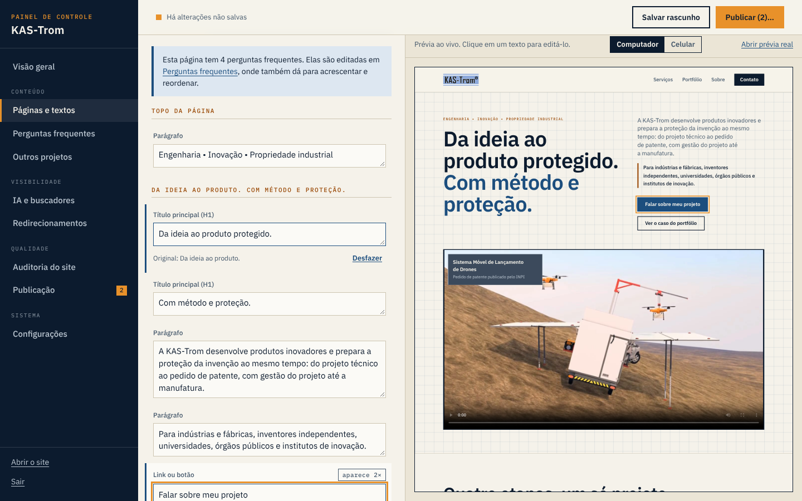

# Painel de controle da KAS-Trom

Um CMS para o site da KAS-Trom Projetos: edita textos, perguntas frequentes, a vitrine de outros projetos, títulos e descrições de busca, o `llms.txt` e redirecionamentos, com rascunho, prévia, publicação e histórico. Inclui uma auditoria automática do site.

Roda no próprio Worker da Cloudflare que já entrega o site. **O site original não é alterado**: as edições ficam guardadas na Cloudflare e são aplicadas sobre as páginas no momento da entrega. Sem edições publicadas, o site sai idêntico ao que foi construído, byte a byte.



## Situação

- O painel **não está no ar**. Ele está pronto e testado neste repositório; falta juntá-lo ao projeto do site e publicar. O passo a passo está em [`docs/INTEGRACAO.md`](docs/INTEGRACAO.md).
- O código-fonte do site (o projeto Astro) não está neste repositório. O painel foi desenvolvido e testado contra uma cópia das páginas publicadas, guardada em `testes/fixtures/site`.
- O relatório completo da auditoria e do QA do site está em [`docs/AUDITORIA.md`](docs/AUDITORIA.md). O ponto mais urgente não depende do painel: o domínio `kastrom.eng.br` não está ligado ao site.

## O que o painel faz

| Tela | Para quê |
|---|---|
| Visão geral | O que está no ar, o que aguarda publicação e a nota da última auditoria |
| Páginas e textos | Editar qualquer texto de qualquer página, com prévia ao vivo (clique no texto da prévia para ir ao campo). Título e descrição de busca com contador e prévia do resultado no Google |
| Perguntas frequentes | Editar, acrescentar, remover e reordenar. A página e os dados estruturados (FAQPage) mudam juntos |
| Outros projetos | Vitrine na página inicial: vídeos curtos de mockup com capa, nome, segmento, ano e descrição. O vídeo é enviado pelo painel e a capa é gerada automaticamente |
| IA e buscadores | `llms.txt`, perfis oficiais da empresa (`sameAs`), conferência dos dados estruturados e do `robots.txt` |
| Redirecionamentos | Endereços antigos que devem levar a endereços novos |
| Auditoria do site | Cerca de 50 verificações de SEO, IA (GEO e AEO), tecnologia, acessibilidade e conteúdo, com o que resolver no painel e o que depende do código |
| Publicação | Lista do que mudou, publicar, descartar, histórico e restauração de versões |
| Configurações | Cópia de segurança (baixar e carregar) |

O que ele **não** faz: criar páginas, trocar o desenho ou a estrutura das páginas. Isso continua no código do site.

## Como funciona

```
visitante ──► Worker da Cloudflare ──► arquivos do site (HTML pronto)
                    │
                    ├─ lê as edições publicadas (Workers KV)
                    └─ aplica sobre o HTML enquanto ele passa:
                       textos, título e descrição, perguntas frequentes,
                       vitrine de projetos e dados estruturados (JSON-LD)
```

- **Cada texto é encontrado pelo próprio texto.** O painel guarda pares "texto original → texto novo". Por isso um texto que se repete (um botão, por exemplo) muda em todos os lugares de uma vez, e nada depende de marcações especiais no código do site.
- **Se o código do site mudar** e um texto de origem deixar de existir, a edição correspondente perde o efeito. O painel avisa na tela "Publicação" e na auditoria.
- **Rascunho e publicação são separados.** O rascunho só aparece para quem está logado, pelo endereço `?cms=rascunho`.
- **Se o CMS falhar** (banco fora do ar, erro no código), o Worker entrega a página original.

## Segurança

- Senha conferida com PBKDF2-SHA-256 (100 mil iterações); só o código embaralhado fica na Cloudflare.
- Sessão em cookie assinado (HMAC), `HttpOnly`, `Secure`, `SameSite=Strict`, com 12 horas de duração.
- Trava de tentativas de login por endereço IP.
- A API só aceita pedidos da mesma origem e em JSON.
- Tudo o que o painel envia é validado de novo no servidor; nenhum HTML digitado no painel chega à página sem ser neutralizado.
- Arquivos enviados são conferidos pelo conteúdo (não pelo nome), limitados a 10 MB e aos tipos MP4, WebM, JPG, PNG e WebP.
- O painel e a API ficam fora dos buscadores (`noindex`) e sem cache.
- Textos sugeridos marcados com `[CONFIRMAR]` não podem ser publicados enquanto a marca não for apagada.

## Rodar no seu computador

Precisa do [Node.js](https://nodejs.org) 22 ou mais novo.

```bash
npm install
npm run dev
```

Abra `http://localhost:8787/admin/`. A senha de desenvolvimento aparece no terminal na primeira vez (`kastrom-desenvolvimento`). O ambiente local usa a cópia do site em `testes/fixtures/site`; para atualizá-la a partir do site no ar, rode `npm run espelhar`.

## Comandos

| Comando | O que faz |
|---|---|
| `npm run dev` | Sobe o site e o painel no computador |
| `npm test` | Testes de unidade (validação, senha, sessão, dados estruturados) |
| `npm run test:e2e` | Testes de ponta a ponta: API, camada de edição e o painel no navegador |
| `npm run senha -- "sua senha"` | Gera os dois segredos que a Cloudflare precisa |
| `npm run videos -- origem destino` | Reduz vídeos de mockup e gera as capas (precisa do FFmpeg) |
| `npm run espelhar` | Atualiza a cópia local das páginas do site |

Os testes do painel no navegador usam o Playwright, que é opcional: `npm i -D playwright && npx playwright install chromium`. Sem ele, rodam só os testes da API.

## Organização

```
admin/            o painel (HTML, CSS e JavaScript puros, sem etapa de compilação)
  js/comum.js     regras usadas pelo painel e pelo Worker (validação, comparação de textos)
  js/telas/       uma tela por arquivo
worker/
  index.js        ponto de entrada: decide quem atende cada pedido
  video.js        entrega dos vídeos do site (código que já estava publicado)
  cms/            API, sessão, armazenamento, mídia e a camada de edição
conteudo/         rascunho sugerido (perguntas frequentes e títulos) para carregar no painel
scripts/          ambiente local, senha, vídeos, cópia do site
testes/           unidade, ponta a ponta e a cópia do site usada nos testes
docs/             auditoria do site e guia de integração
```

As fontes em `admin/fontes` são IBM Plex Sans e IBM Plex Mono (licença SIL Open Font License 1.1), as mesmas do site.
